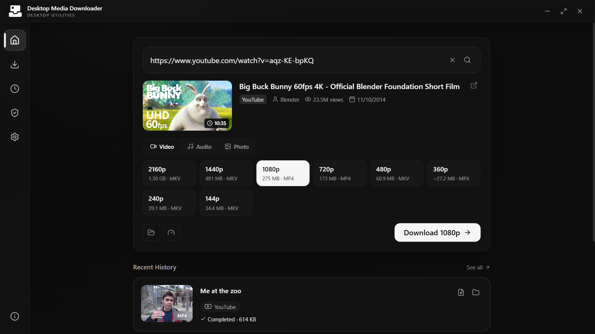
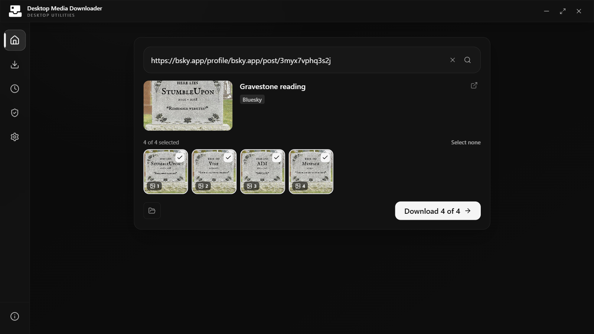
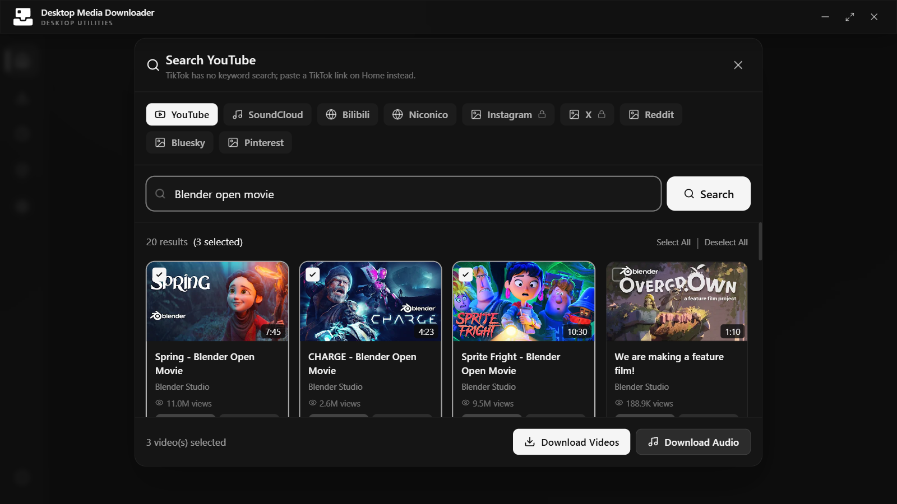
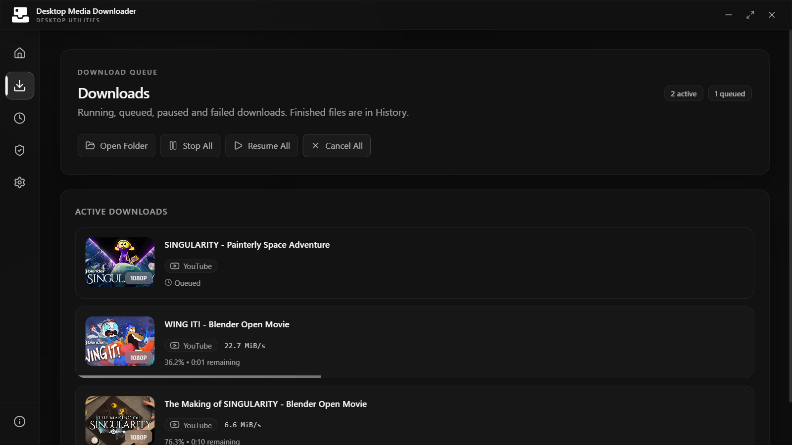

# Desktop Media Downloader

<p align="center">
  <picture>
    <source media="(prefers-color-scheme: dark)" srcset="branding/desktop-media-downloader-icon-inverted.svg" />
    
  </picture>
</p>

<p align="center">
  An open-source desktop media downloader for Windows, macOS, and Linux.
</p>

<p align="center">
  <a href="https://desktoputilities.github.io/desktop-media-downloader/download/">Download</a>
  ·
  <a href="https://github.com/desktoputilities/desktop-media-downloader/releases">Releases</a>
  ·
  <a href="#development">Development</a>
</p>

Desktop Media Downloader is an open-source media downloader for Windows, macOS, and Linux. It provides a focused graphical interface for yt-dlp and gallery-dl to save video, audio, images, and multi-image posts, with exact file sizes, multi-site search, and a download queue. No terminal workflow is required.

It is a [Desktop Utilities](https://github.com/desktoputilities) project built with Electron, React, and TypeScript. The interface uses a professional monochrome design with native light and dark modes.

## Features

- Video, audio, single images, and multi-image posts (Instagram, X, TikTok photo posts, Reddit, Bluesky, Pinterest, and more), with a picker for the items to keep
- Exact file size and format for every quality before a download starts
- Search across YouTube, SoundCloud, Bilibili, Niconico, Reddit, Bluesky, Pinterest, Instagram hashtags, and X
- A download queue with a parallel limit, pause, resume, retry, cancel, and local history
- Playlist selection and batch downloads
- Per-site cookie import (cookies.txt or JSON) for sites that need an account; each site's cookies are sent only to that site
- Bundled, checksum-verified yt-dlp and gallery-dl that update themselves from their official releases
- In-app updates on Windows and Linux
- Graceful no-FFmpeg fallback for compatible combined streams
- Windows, macOS, and Linux installers built by GitHub Actions

## Supported media sites

The app works with YouTube and the other websites supported by yt-dlp and gallery-dl. Site support changes as platforms update, so both engines are bundled at pinned, checksum-verified versions and then kept current from their official releases, each download verified against its published checksum.

Only download media you own or are authorized to save. Desktop Media Downloader is not designed to bypass DRM, paywalls, or access controls.

## Screenshots

| Link preview and qualities | Multi-image posts |
| --- | --- |
|  |  |

| Search | Download queue |
| --- | --- |
|  |  |

## Install

Download the latest `.exe`, `.dmg`, or `.AppImage` from the [download page](https://desktoputilities.github.io/desktop-media-downloader/download/) or [GitHub Releases](https://github.com/desktoputilities/desktop-media-downloader/releases).

The project is open source and is not currently commercially code-signed. Windows SmartScreen or macOS Gatekeeper may therefore display a trust warning on first install. Review the source and download only from the official organization links above. After that, Windows and Linux installs update from within the app (Info → Update); macOS opens the download page.

## Development

Node.js 24 or later and npm 11 or later are recommended.

```bash
git clone https://github.com/desktoputilities/desktop-media-downloader.git
cd desktop-media-downloader
npm ci
npm run dev
```

`npm ci` downloads the matching Electron runtime and the pinned official yt-dlp and gallery-dl standalone builds, then verifies their checksums. FFmpeg is optional but recommended for merging separate audio/video streams and media conversion. No separate Python or system yt-dlp installation is required.

### Verification and packaging

```bash
npm run check
npm run build:app
npm run build:bundled
```

| Command | Purpose |
| --- | --- |
| `npm run dev` | Run the desktop app in development mode |
| `npm run check` | Run tests, lint, and TypeScript checks |
| `npm run build:app` | Compile the renderer, main process, and preload bundles |
| `npm run build:bundled` | Prepare dependencies and build the platform installer |
| `npm run prepare:yt-dlp` | Download and checksum-verify the pinned yt-dlp |
| `npm run prepare:gallery-dl` | Download and checksum-verify the pinned gallery-dl |

See [SYSTEM_REQUIREMENTS.md](SYSTEM_REQUIREMENTS.md) for platform-specific details.

## Release process

1. Set the release version in `package.json`.
2. Run `npm run check` and `npm run build:bundled` locally.
3. Push the matching tag, such as `v1.0.0`.
4. GitHub Actions verifies the tag, tests the project, and creates installers and update files (`latest*.yml`) for all supported platforms.
5. The download page and the in-app updater read the latest assets from the GitHub release.

To publish the download page, enable GitHub Pages from the `main` branch and `/docs` folder in repository settings.

## Project structure

```text
.github/        Continuous integration and release automation
branding/       Canonical SVG brand sources
build/icons/    Installer icon sources
docs/           GitHub Pages download site and screenshots
electron/       Electron main process, preload, and media engine integration
public/         Renderer assets
scripts/        Dependency and release verification helpers
src/            React renderer
bin/            Generated bundled runtime (not committed)
```

## Contributing

Bug reports and focused pull requests are welcome. Read [CONTRIBUTING.md](CONTRIBUTING.md) before submitting changes.

## Legal

MIT licensed. See [LICENSE](LICENSE), [LEGAL.md](LEGAL.md), and [THIRD_PARTY_NOTICES.md](THIRD_PARTY_NOTICES.md).

This software is for lawful use only. Users are responsible for copyright compliance, local law, and platform terms of service.
